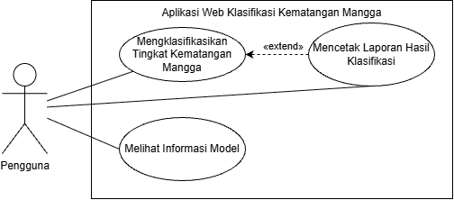

# Proyek Belajar Business Analyst: Dokumentasi Kebutuhan Aplikasi Klasifikasi Kematangan Mangga

## English Summary

This is my first learning project in Business Analysis. I used my undergraduate thesis team's web app, which classifies mango ripeness from photos, as a case study. After the app was finished, I tested it myself and wrote a short Business Requirements Document (BRD), a use case diagram, a use case specification, and learning notes. The documents are written in Indonesian. I used AI as a reviewer and for language editing.

---

## Tentang Proyek Ini

Ini proyek pertama saya mempelajari dokumentasi Business Analyst. Saya memakai aplikasi web dari skripsi tim saya sebagai studi kasus, menguji aplikasinya sendiri, lalu menulis dokumen kebutuhannya secara retrospektif, yaitu setelah aplikasi selesai dibangun.

Tujuan saya bukan menunjukkan bahwa saya sudah ahli, tetapi belajar cara berpikir seorang BA: memahami masalah pengguna, menuliskan kebutuhan dengan jelas, dan memeriksa apakah dokumen sesuai dengan sistem yang sebenarnya.

## Tentang Aplikasinya

Aplikasi ini dibuat untuk skripsi berjudul *Klasifikasi Tingkat Kematangan Buah Mangga Menggunakan Transfer Learning dengan EfficientNet-B0* (S1 Informatika, Universitas Mikroskil, 2026).

- **Masalah:** penyortiran mangga berdasarkan tingkat kematangan masih dilakukan secara visual oleh operator, sehingga hasilnya bisa berbeda antarorang.
- **Fungsi aplikasi:** pengguna mengunggah foto mangga, lalu aplikasi mengelompokkannya ke empat kelas (mentah, setengah matang, matang, busuk) beserta tingkat kepercayaannya.
- **Status:** prototipe penelitian yang berjalan secara lokal. Aplikasi belum pernah dipakai oleh operator penyortiran.

## Isi Repositori

| File | Isi |
| --- | --- |
| `01-BRD-Ringkas.pdf` | Masalah, tujuan, ruang lingkup, 8 kebutuhan fungsional, kebutuhan non-fungsional, dan risiko |
| `02-Diagram-Use-Case.png` | Diagram use case (1 aktor, 3 use case) |
| `02-Diagram-Use-Case.drawio` | File sumber diagram, bisa dibuka di draw.io |
| `03-Spesifikasi-Use-Case-UC-01.pdf` | Alur utama, alur alternatif, dan alur pengecualian untuk use case utama |
| `04-Catatan-Pembelajaran.pdf` | Tiga temuan, apa yang saya pelajari, dan batasan proyek ini |

## Peran Saya

- **Dalam skripsi:** saya ketua tim beranggotakan tiga orang. Aplikasi web dibangun oleh rekan tim saya. Saya mengusulkan empat fitur tambahan: tampilan seluruh hasil di aplikasi, diagram jumlah prediksi per kelas, ringkasan prediksi cocok/tidak cocok, dan panel referensi kelas kematangan.
- **Dalam proyek ini (Oktober 2026):** saya menguji aplikasi sendiri dan menulis seluruh dokumen di repositori ini.

## Tiga Temuan Utama

1. **Status "Tepat/Tidak Tepat" bergantung pada nama folder.** Saya sengaja menukar nama dua folder, dan prediksi yang sebenarnya benar ditandai "Tidak Tepat".
2. **Waktu tunggu pengguna jauh lebih lama daripada waktu inferensi model.** Skripsi mencatat sekitar 6,8 ms per gambar, tetapi saya mengukur rata-rata 18,6 detik untuk 143 gambar, sekitar 20 kali lebih lama.
3. **Dokumentasi skripsi berbeda dengan aplikasi yang sebenarnya.** Contohnya, tombol "unduh" ternyata membuka dialog cetak browser, dan laporan PDF tidak memuat ringkasan hasil yang tampil di dashboard.

Penjelasan lengkapnya ada di `04-Catatan-Pembelajaran.pdf`.

## Cara Saya Mengerjakannya

1. Membaca ulang bab metodologi dan hasil di skripsi.
2. Mencoba setiap fitur aplikasi secara langsung, termasuk mengunggah file yang tidak valid dan menukar nama folder.
3. Mengukur waktu tunggu dengan stopwatch sebanyak tiga kali.
4. Menulis BRD ringkas, lalu menggambar diagram use case di draw.io.
5. Menulis spesifikasi use case untuk alur utama.
6. Menulis catatan pembelajaran.

## Batasan

- Dokumen ditulis setelah aplikasi selesai, sehingga sebagian kebutuhan disusun berdasarkan fitur yang sudah ada.
- Aplikasi belum diuji oleh pengguna nyata di lingkungan kerja.
- Saya menggunakan AI (Claude) untuk meninjau dokumen dan merapikan bahasa. Pengujian aplikasi dan pengukuran waktu saya lakukan sendiri.

## Alat yang Digunakan

draw.io · Google Chrome · Claude (AI, sebagai reviewer)

## Kontak

- LinkedIn: (https://www.linkedin.com/in/helgayulianiputriaritonang/)
- Email: helgaaritonang6@gmail.com
